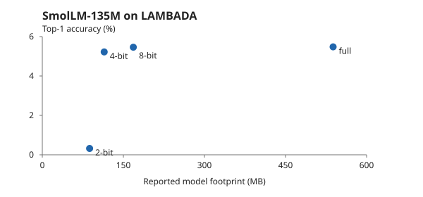

# Model quantization on a language benchmark

A project for AI/ML in the Era of Climate Change (194.125, winter 2024). We evaluated GPTQ-quantized [SmolLM-135M](https://huggingface.co/HuggingFaceTB/SmolLM-135M) on the [LAMBADA](https://huggingface.co/datasets/cimec/lambada) test split. Each logged run evaluated 5,000 examples.

The [summary](results.csv) reports medians per configuration from the original runs. In these runs, four-bit quantization came close to the eight-bit top-1 accuracy while reducing the reported model footprint. Two-bit quantization reduced the footprint further but also sharply reduced accuracy. The full-precision reference has just one logged run. The footprint is the original benchmark's reported model memory, not peak process memory.



The figure can be regenerated with plain Python:

```sh
python plot.py
```

The original experiment was a collaboration. [achimbo](https://github.com/achimbo) contributed benchmark code and results. This summary does not redistribute the original code, raw logs, evaluation dataset, model weights, or assignment materials.
