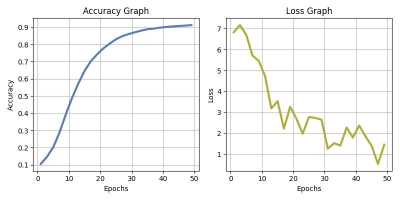

# autocomplete

A PyTorch LSTM that predicts the next word from the preceding words. The project compares recurrent and transformer prototypes before settling on an LSTM trained on news headlines.

The reported run reached 16.65% top-3 accuracy on the held-out split, despite exceeding 90% on the training split. The gap is a useful example of why training accuracy alone is a poor measure of whether a model generalizes.

